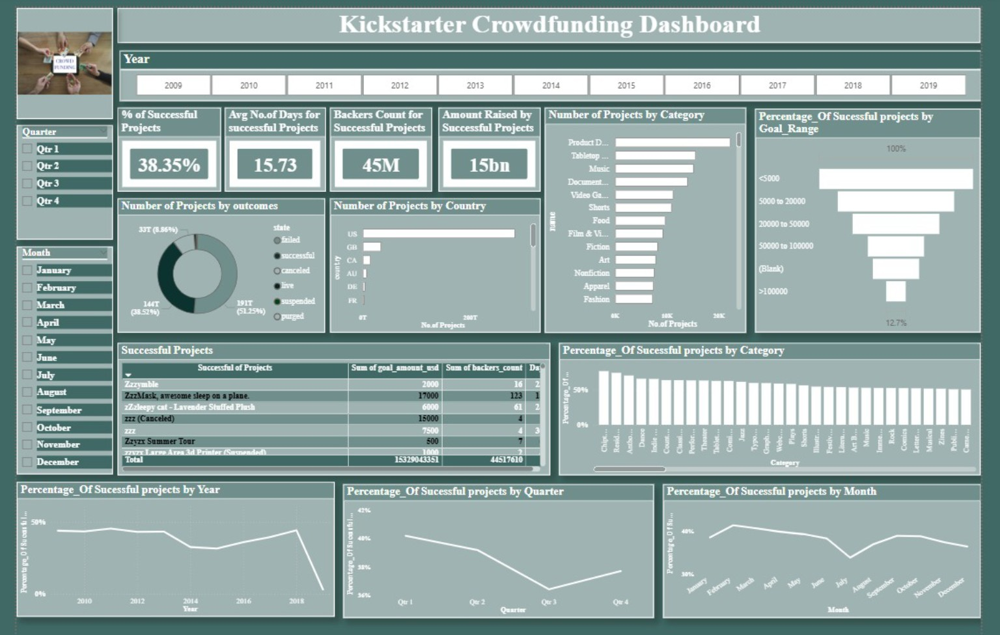

# Kickstarter Crowdfunding Data Analysis Dashboard

## Project Overview

Developed a Kickstarter Crowdfunding Dashboard using Power BI to analyze crowdfunding campaign performance and project success trends.

## Key Insights

- Percentage of successful projects
- Average duration of successful projects
- Backer count and amount raised
- Projects by category and country
- Successful projects by funding goal range
- Project success trends by year, quarter and month

## Tools Used

- Microsoft Power BI
- Data Visualization
- Data Analysis

## Dashboard Preview

## Objective

To understand crowdfunding campaign performance, identify successful project categories and analyze funding trends.

